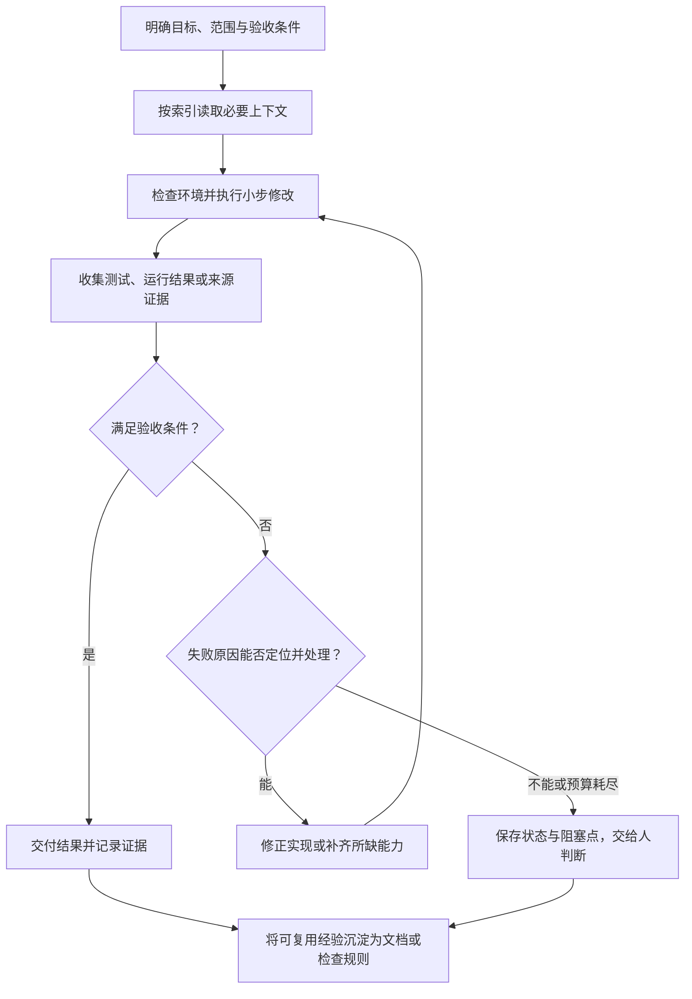

# Harness Engineering：以 Agent 为中心的工程实践

## 当前目标

最近在学习如何搭建 AI 相关的 pipeline 工作流，希望理解如何把模型、工具、上下文和验证机制组织成一个能够持续完成任务的流程。

> [!abstract] 核心理解
> Harness Engineering 关注模型周围的工程环境：让 Agent 找得到知识、用得上工具、看得见运行结果，并通过约束和反馈持续修正。工程师的工作随之更多地转向定义目标、建设环境和判断结果。

## 1. 文章背景与阅读边界

- 作者：Ryan Lopopolo，OpenAI 技术团队成员。
- 发布日期：2026-02-11；本次补充阅读：2026-10-30。
- 场景：一个从空仓库起步、已经有内部用户和外部 alpha 测试者的软件产品。
- 团队主动设置了“不由人直接编写代码”的实验约束；产品代码、测试、CI、文档和内部工具都交给 Codex 生成，人负责引导与验收。

原文报告，约五个月内形成了百万行量级的仓库，合入约 1,500 个 PR，最初由三名工程师驱动，团队后来扩大到七人；作者估计耗时约为手写代码的十分之一。

> [!warning] 数字的适用范围
> 这些是特定团队的经验报告与估计，没有提供可复现的对照实验。代码行数和 PR 数也不能单独证明产品质量。“零手写代码”是这次实验的约束，不能据此推导出所有团队都应该采用同样策略。原文也明确保留了多年维护与架构演化方面的未知问题。

以下第 2 节是阅读时使用的概念拆解，第 3–4 节整理原文实践，第 5–6 节是结合已有笔记的延伸与待实践方案。来源见文末的[中英文原文](https://openai.com/zh-Hans-CN/index/harness-engineering/)。

## 2. Harness 可以怎样理解

在这篇文章的语境下，可以把 harness 理解为支撑 Agent 完成工作的整套工程设施，而不只是一个测试脚本。下面是便于学习的拆解，并非原文提出的标准分类：

| 层面 | 要回答的问题 | 可能的载体 |
| --- | --- | --- |
| 任务与意图 | 要完成什么，怎样算完成？ | 需求、验收条件、范围与限制 |
| 上下文 | 去哪里找可靠信息？ | AGENTS.md、索引、架构文档、设计记录 |
| 执行环境 | 能读写什么，怎样运行系统？ | CLI、浏览器、隔离工作目录、应用启动脚本 |
| 反馈与约束 | 怎样发现错误、判断效果？ | 测试、lint、结构检查、日志、指标、trace |
| 状态与维护 | 怎样续跑、交接并防止质量退化？ | 执行计划、进度、决策日志、技术债与清理任务 |

Prompt 用来表达当前意图；harness 把需要反复使用的知识、能力和检查沉淀下来。两者共同作用。例如，“修复启动慢的问题”需要明确指标口径、可启动的环境、可查询的耗时数据，以及修改后的复测路径。

原文反复强调的工程动作，是在失败时识别缺失能力，再把它变成 Agent 能发现、使用或执行的设施。这样，单次修复才有机会改善后续任务。

## 3. 原文中的关键工程实践

### 3.1 把仓库知识做成可导航、可维护的系统

团队尝试过把所有要求堆进一个巨大的 AGENTS.md，但遇到上下文挤占、重点模糊、内容过时和难以自动检查的问题。之后改成简短入口加分层文档：Agent 先获得地图，再按任务读取细节。

原文目录可以简化为：

```text
AGENTS.md                 工作入口与导航
ARCHITECTURE.md           领域和模块地图
docs/
  design-docs/            设计与原则
  product-specs/          产品行为与需求
  exec-plans/             活跃计划、完成计划与技术债
  references/             外部工具与依赖参考
  generated/              生成的结构信息
```

复杂任务的计划、进度和决策会进入版本控制，使下一次运行不必依赖上一段聊天。文档也需要维护：用检查器验证结构和交叉链接，再用定期的文档维护任务发现与代码行为不一致的内容。

这里的重点是**渐进式披露与持续校验**。原文约百行的入口只是实例，不是通用行数指标。本 vault 的 AGENTS.md、`.agent/index.md`、主题笔记和 `.agent/log.md` 可以与之对照，知识维护模式见 [[LLM Wiki]]。

### 3.2 让运行中的应用也对 Agent 可读

只读源码不足以判断很多产品问题。团队为每个 git worktree 提供独立的应用实例，并接入浏览器操作能力，让 Agent 能读取 DOM、截图、导航、复现问题和验证修复。

日志、指标和 trace 也通过临时的本地观测环境暴露给 Agent，并随对应工作环境清理。原文举例，Agent 可使用 LogQL 查日志、PromQL 查指标，于是“启动耗时低于 800ms”这类目标有了可观察的反馈。

阅读时可以把“可读性”分成两部分：

- **静态可读**：需求、设计、代码、接口和历史决策能被发现并理解。
- **动态可读**：实际运行行为、失败过程和效果变化能被观察并比较。

这两部分共同支撑“复现 → 修改 → 验证”。原文没有据此证明单次截图或测试就能覆盖所有行为。

### 3.3 用程序执行架构约束，并让错误信息帮助修复

文档说明规则，lint 和结构测试负责让关键规则持续生效。原文把业务域划分为固定层，验证依赖方向；认证、遥测等横切能力通过显式的 Providers 接入。

需要迁移的是**明确边界并机械检查**的思路，具体层名不必照搬。例如，要求外部数据在边界完成解析与验证，同时允许 Agent 在边界内选择实现方式。

团队还将结构化日志、命名约定、文件大小和部分可靠性要求写入检查器。自定义错误信息包含修复指导，使失败输出可以成为下一步操作的输入。

下面是对这种设计方式的延伸示例，并非原文代码：

```text
检查失败：UI 层直接访问数据库。
规则：数据访问应经过既定的服务接口。
下一步：参考现有同类模块，将查询迁到允许的数据访问位置，再重跑检查。
```

约束要保护正确性、边界和可维护性；对局部表达方式保留自由。人的 review 意见如果反复出现，就值得判断能否整理成文档或检查规则。

### 3.4 优先提供 Agent 能发现和推理的知识与抽象

团队把重要的产品原则、架构共识和设计记录沉淀进仓库，减少只存在于聊天或个人脑海中的知识。选择依赖时，也重视行为稳定、可理解、可检查的实现。

原文提到，他们为特定需求实现了一个与遥测集成的并发工具。这是局部权衡，不能概括成“Agent 项目应该重写第三方库”。需要考虑的仍包括复用收益、维护成本、行为透明度和可验证性。

同样，“运行时不可访问的信息对 Agent 不存在”描述的是可访问性限制。若有可靠的外部知识工具，也可以读取仓库外资料；关键是入口可发现、来源可追溯、内容可核对。

### 3.5 把审查、反馈和恢复接入完整工作流

原文的 Agent 会使用开发工具收集上下文，进行本地自审、请求额外审查、响应反馈并迭代。团队逐步把大量审查工作交给 Agent 之间完成，人仍负责优先级、验收标准和结果判断。

后续形成的端到端能力包括复现故障、录制前后视频、修复、操作应用验证、创建 PR、处理反馈与构建失败，必要时交给人判断，最后合并。

原文明确指出，这依赖该仓库长期建设的结构和工具。长时间自主工作是这些能力组合后的结果，不能只靠延长循环获得。关于循环和终止条件，可继续看 [[Claude Code Loop 工程：loop、goal 与 schedule]]；独立审查的收益和成本见 [[Subagent 的好处与适用边界]]。

### 3.6 持续清理，避免坏模式被不断复制

Agent 会模仿仓库中的既有模式，已有的重复实现和不良结构也可能随之扩散。团队最初依靠每周集中人工清理，后来改为把质量原则编码，并定期扫描偏离、更新质量记录、发起小范围重构 PR。

这里有两个不同的反馈循环：

1. **任务内反馈**：发现当前改动的问题，修到满足验收条件。
2. **跨任务反馈**：将反复出现的问题转成共享工具、规则和维护任务，降低下一次再犯的概率。

这也是文中“垃圾回收”比喻的意义：用持续的小修正控制技术债，避免等到大规模退化后才集中返工。

## 4. 吞吐量与合并策略：需要保留的边界

原文团队采用较少的阻塞式合并门禁、短生命周期 PR，并对偶发测试失败通过后续运行处理。作者的理由是，在其环境里，Agent 修正很快，而等待会消耗稀缺的人类注意力。

这与 [[AI 代码 Review 策略]] 中对高危代码和人工确认的保守约定存在不同取舍，不能直接替换成本仓库的操作规则。

> [!note] 我的理解
> 合并策略应结合错误后果、发现延迟、回滚能力和修复成本设计。原文给出了一个高吞吐团队的经验，不能推导出忽略确定性测试失败、取消高风险审查，或默认授予 Agent 合并与发布权限。

原文尚未回答多年运行后的架构一致性问题，也没有给出跨团队通用的可靠性保证。评价这套方法时，需要同时看交付效率、返工和长期质量。

## 5. 把初步思路扩展为可执行闭环

下面保留原先“目标 → 上下文 → 执行 → 检查 → 修正”的思路，并补上失败分类和经验沉淀。这是个人实践框架，**尚未在本笔记中完成实验**。



为避免混淆“做事”和“证明做完”，可以分别设计：

- **执行路径**：Agent 如何读取、修改、编译、运行或检索。
- **验收路径**：哪些证据支持结果，测试和来源有哪些覆盖限制。
- **控制路径**：谁决定重试、停止、恢复或请求人工判断。

模型适合处理语义理解、提出候选方案和解释反馈；确定的边界、计数和状态转换，在需要强制保证时可以交给代码控制。具体划分应随任务复杂度决定。

### 与已有工程笔记的对应

| 已有笔记 | 可以进一步观察的具体实现 |
| --- | --- |
| [[LLM Wiki]] | 索引、来源、交叉链接与持续知识维护 |
| [[AI 代码 Review 策略]] | 可验证信号、风险分级与审查带宽 |
| [[KernelAgent：硬件反馈驱动的 GPU Kernel 优化]] | 正确性验证、硬件测量、候选筛选与实验历史 |
| [[KDA：Agent 驱动的 CUDA Kernel 开发工作流]] | 任务契约、计划、独立验收、反馈续跑与实验状态 |

KernelAgent 和 KDA 是本 vault 中的延伸案例，不属于 OpenAI 原文。它们可以帮助观察同一组问题怎样落到 GPU 工作流：结果由正确性检查与实测支撑，不能只看模型对优化收益的解释。

## 6. 下一步实践

优先选一个熟悉、范围小、可以复现的任务，先跑通单 Agent 闭环；遇到足够独立的任务时，再评估委派与并行的收益。

下面是待填的任务契约模板：

```text
目标：要解决的具体问题。
范围：允许修改的文件、工具与资源。
上下文入口：已有实现、相关文档和历史决策。
起点：当前行为、复现步骤与基线结果。
验收：检查方法、比较口径、证据保存位置。
失败处理：如何区分实现错误、环境问题与目标不清。
停止条件：验收通过；或达到重试/时间预算；或需要人判断。
交付：产物、验证结果、未解决问题与恢复步骤。
```

目前仍待完成：

- [ ] 选择一个小场景：编码与调试、文章与论文整理，或模型工程流程。
- [ ] 明确每一步的输入、输出，以及哪些步骤由代码控制、哪些交给模型判断。
- [ ] 跑通一次完整流程，记录人工介入的位置和失败案例。
- [ ] 补上失败处理、重试上限与日志，再评估是否需要更复杂的编排。
- [ ] 从一次真实失败中提炼一条可复用改进，在后续任务中观察是否有效。

复盘时可记录人工介入次数与原因、首次验收通过率、重复失败类型，以及总体耗时和返工量。暂不预设“必须全自动”，先判断环境建设是否确实减少了重复劳动。

## 参考资料与整理说明

- [Harness engineering: leveraging Codex in an agent-first world（英文原文）](https://openai.com/index/harness-engineering/)
- [Harness Engineering（中文版）](https://openai.com/zh-Hans-CN/index/harness-engineering/)

本次依据 OpenAI 官方中英文页面整理，属于文章阅读与实践设计，没有访问作者的内部仓库，也未复现文中的效率数字。新增的概念分类、闭环图、任务模板和个人实践指标均为阅读延伸。
