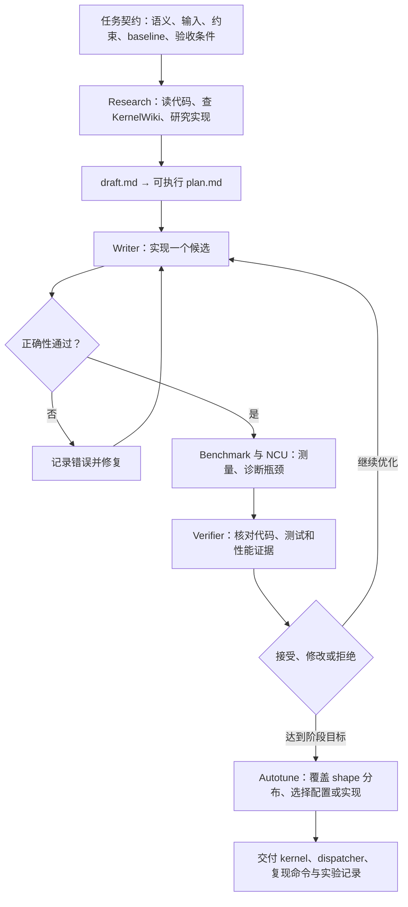
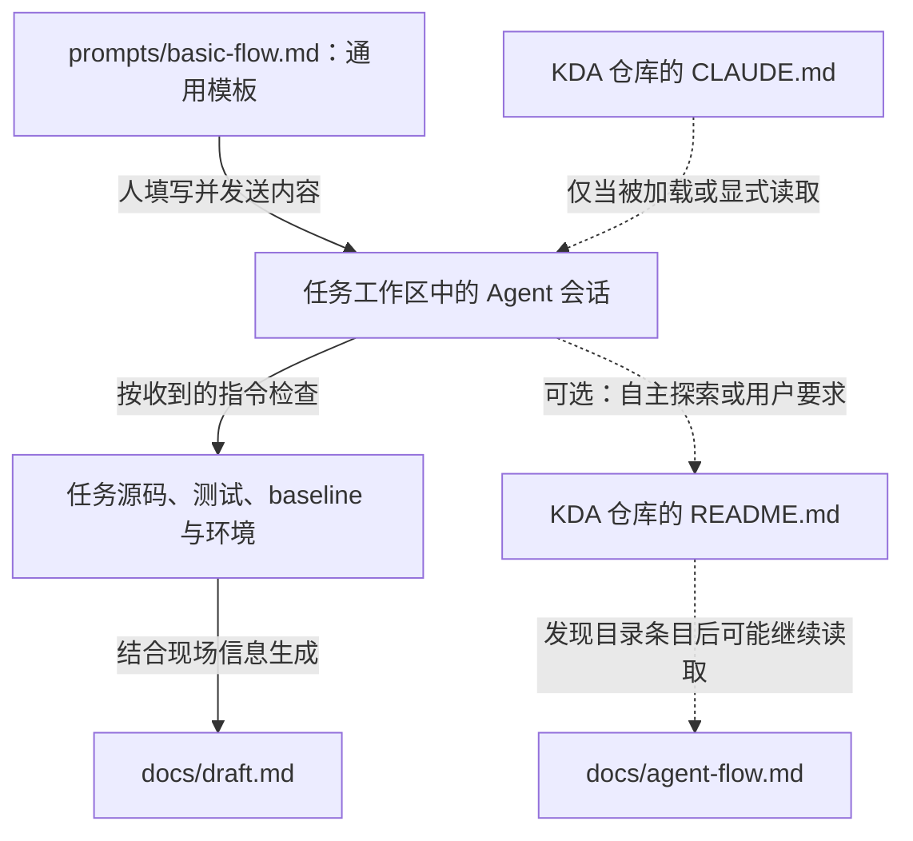
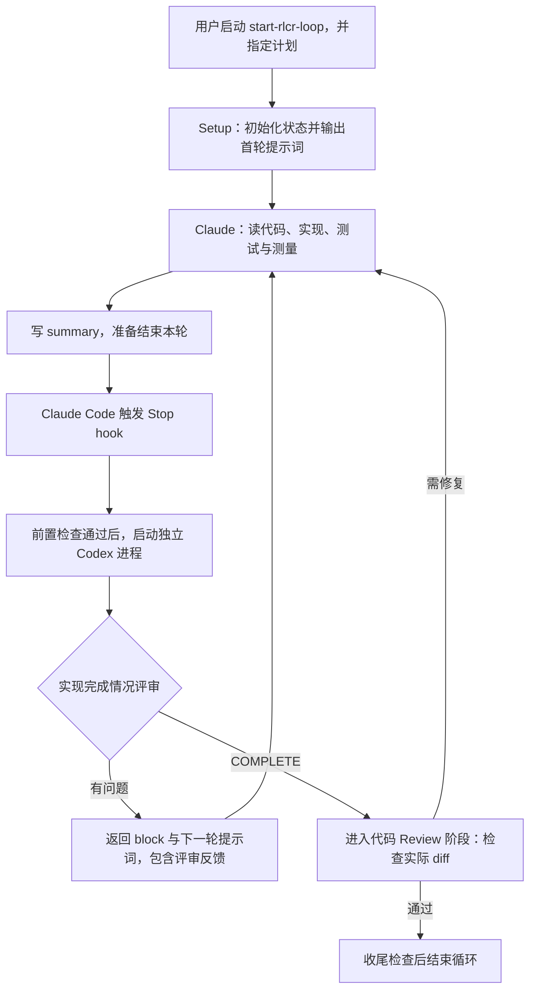

# KDA：Agent 驱动的 CUDA Kernel 开发工作流

> [!abstract] 核心思路
> 把 CUDA kernel 开发组织成有验收条件、有知识检索、有硬件反馈、能保留实验状态的工程流程：**定义任务 → 研究与规划 → 实现候选 → 验正确性 → 测性能与诊断 → 独立验收 → 继续迭代**。

这是 [[Harness Engineering：以 Agent 为中心的工程实践]] 的一个具体案例。模型负责研究和实现；工具提供执行与测量能力；任务契约、验证器和实验记录共同约束结果。知识组织方式可联系 [[LLM Wiki]]，硬件反馈优化可对照 [[KernelAgent：硬件反馈驱动的 GPU Kernel 优化]]。

## 1. 阅读范围与证据层次

整理日期为 2026-10-20，基于以下资料：

- [KDA 主仓库](https://github.com/NVlabs/kda/tree/acdd79343c5e9d0c7cb96289f26fd3f1051ce785)：固定到 `acdd79343c5e9d0c7cb96289f26fd3f1051ce785`，重点是 README、`docs/agent-flow.md`、`prompts/basic-flow.md` 和 `CLAUDE.md`。
- [技术报告：Developing GPU Kernels with Agentic Loops](https://github.com/mit-han-lab/mlsys2026-flashinfer-contest/blob/main/docs/HAN_Lab_Kernel_Mafia_Technical_Report.pdf)：重点是 §3 的执行机制与 §5 的局限；此链接随上游 main 更新。
- 仓库固定的两个子模块：[KernelWiki](https://github.com/mit-han-lab/KernelWiki/tree/76d27b56f804e7e7295d4c570e1e5d7eef4b0a75) 与 [ncu-report-skill](https://github.com/mit-han-lab/ncu-report-skill/tree/d1887948c7d53690cfe6605f59c1329b8a1c6bb5)。
- [Humanize v1.16.0](https://github.com/PolyArch/humanize/tree/4eeb392cd2450c3df99cb898bd6b24839967bbc3)：固定到 `4eeb392cd2450c3df99cb898bd6b24839967bbc3`，用于追踪计划加载、Stop hook、Codex 评审与续跑机制；不据此假设它与技术报告运行时使用的版本完全相同。
- [2026-09-27 KDA 案例复盘](https://nvlabs.github.io/kda/blog/2026-09-27-kda-for-kda/)：补充后续实践，应与上述固定版本区分。

> [!note] 阅读边界
> 本文是文档与源码的静态梳理，未在 GPU 上复现实验。后面的 roadmap 是基于这些资料整理的实践建议，不代表官方排期。

理解项目时分清三个层次：

| 层次 | 内容 | 作用 |
| --- | --- | --- |
| 通用工作流仓库 | 文档、任务 prompt、Agent 指令、技能入口 | 约定任务怎样开始、验证和收尾 |
| 配套组件 | Humanize、KernelWiki、NCU report skill | 提供迭代、知识检索和性能诊断能力 |
| 下游任务 workspace | 算子、workload、baseline、验证器、GPU 环境、候选产物 | 决定具体优化什么以及怎样判断成功 |

主仓库要求实际实现工作放在独立 workspace，任务代码、数据和私有评测规则由该 workspace 管理。通用流程允许手动规划；报告中的实践采用 Humanize 编排 writer/verifier。

## 2. 整体流程：外层验收，内层实验

技术报告 §3 将优化过程分为 **Research → Iterative Refinement → Autotuning** 三个阶段。下图综合了通用流程和报告中的独立验收机制；这是概念流程，不代表仓库中存在一个完全固定的调度程序。



图中的 verifier 表达研发职责。当前 Humanize CLI 的自动 review 检查点是 Agent 尝试结束一轮时，不能从此图推断每个候选或小改动后都会触发一次 Stop hook；具体机制见第 3.1 节。

### 2.1 任务契约先于实现

[`basic-flow.md`](https://github.com/NVlabs/kda/blob/acdd79343c5e9d0c7cb96289f26fd3f1051ce785/prompts/basic-flow.md) 要求明确：

- **目标与输入输出**：算子语义、代表性 workload、shape/dtype/layout。
- **正确性要求**：数值误差、边界条件和其他不变量。
- **约束**：实现语言、依赖、API 或部署限制。
- **验证与评测命令**：分别证明正确性和测量目标指标。
- **Promotion criteria**：什么证据足以接受一个新候选。

Agent 先检查已有代码、baseline 和验证路径，再写 `docs/draft.md`，将其转成可执行计划后开始实现。计划需要包含未知问题、按预期收益与风险排序的候选方向、首轮步骤，以及接受或拒绝候选所需的证据。

### 2.2 两条相互配合的循环

**开发与验收循环**：技术报告使用 Claude 编写、Codex 独立验收。计划拆成任务与 acceptance criteria；writer 执行，verifier 根据 diff、测试、profile 和仓库状态判断进度，未通过则反馈修正。遇到阻塞先协作排查，仍无法解决时交给人。

**性能实验循环**：研究方案 → 实现 → 验正确性 → 测量 → 诊断 → 下一次实验。Agent 可以根据现场情况选择读文件、编译、调试、查知识库或 profile 的时机。

这里的“独立验收”要求核对实际证据；另一份自然语言总结本身不能证明实现正确或性能达标。相关职责边界可联系 [[AI 代码 Review 策略]]。

### 2.3 最终产物可以是多个实现与 dispatcher

报告的 autotuning 阶段覆盖真实 workload 的 shape 分布。小规模与大规模输入可能适合不同配置，甚至不同的 kernel 结构，因此最终可以交付 **shape-aware dispatcher**，将输入分派给对应实现。

这是根据合法输入规格做 specialization；跳过输入依赖的实际计算、硬编码测试数据等行为仍违反任务契约。

### 2.4 从 Agent 视角看：哪些文件实际进入上下文

**文件在仓库里存在、文档中提到文件名、文件内容进入 Agent 上下文，是三个不同的动作。** KDA 的主路径依赖使用者传递启动提示词。

| 文件 | 定位与引用 | 是否保证被 Agent 读取 |
| --- | --- | --- |
| `README.md` | 项目入口；要求把填好的 basic-flow 交给 Agent | 使用者会阅读；任务会话是否读取取决于显式输入或自主探索 |
| `CLAUDE.md` | 指示使用 basic-flow；列出可选 Humanize | 仅当该文件被宿主加载或 Agent 显式读取；独立任务 workspace 未必加载 KDA 仓库的指令 |
| `docs/agent-flow.md` | 解释整体流程与证据记录约定 | CLAUDE.md 没有引用它，官方步骤也没有要求 Agent 必须读取 |
| `prompts/README.md` | 说明模板用法：复制进会话、替换占位符 | 使用说明，不是自动加载器 |
| `prompts/basic-flow.md` | 实际交给 Agent 的任务启动模板 | 填好后发送内容，或明确指示 Agent 读取，才能建立输入路径 |

引用依据是 [README 的启动步骤](https://github.com/NVlabs/kda/blob/acdd79343c5e9d0c7cb96289f26fd3f1051ce785/README.md#L64)、[CLAUDE.md 的 starter prompt 指令](https://github.com/NVlabs/kda/blob/acdd79343c5e9d0c7cb96289f26fd3f1051ce785/CLAUDE.md#L19) 和 [prompts/README.md 的复制说明](https://github.com/NVlabs/kda/blob/acdd79343c5e9d0c7cb96289f26fd3f1051ce785/prompts/README.md#L13)。



实线表示文档要求的主路径，虚线表示条件路径；均不表示代码 import。KDA 中没有自动注入 basic-flow 的加载器。CLAUDE.md 中“使用某文件”的自然语言指令，也不会自行把该文件正文展开到上下文里。

`agent-flow.md` 没有指向 `basic-flow.md` 的引用。Agent 可以通过探索发现它，但不能仅因文件存在就认定 Agent 已经看过。

### 2.5 basic-flow、draft 与 plan 的交接

| 材料 | 回答的问题 | 典型内容 |
| --- | --- | --- |
| 填好的 basic-flow | 要完成什么任务，怎样工作？ | 目标、约束、验证命令、接受条件与工作流要求 |
| `docs/draft.md` | 看过现场代码后，准备怎样做？ | baseline、风险、未知问题、候选方向、优先级和首轮实验 |
| `docs/plan.md` | 按哪些步骤执行和验收？ | 明确任务、依赖、执行顺序与验收条件 |

draft 是 Agent 调研后的中间产物，可以保留假设与备选方案；plan 将其收敛成可执行步骤。文件生成本身不会自动启动下一阶段。

采用 Humanize 的常见衔接为：

```text
人将填好的 basic-flow 交给 Agent
    → Agent 读代码与环境，生成 docs/draft.md
    → /humanize:gen-plan --input docs/draft.md --output docs/plan.md
    → /humanize:start-rlcr-loop docs/plan.md
```

basic-flow 直接规定了 `docs/draft.md` 的路径，但只要求把草稿转成可执行计划，没有指定最终计划必须命名为 `docs/plan.md`；该名称来自整体流程的约定。Humanize 使用启动参数指定的计划文件，并非自动搜索这个固定文件名。

如果将填好的模板另存为 `docs/task.md` 等文件，这是使用者自行选择的保存方式，KDA 没有要求该文件名。

## 3. 工具与组件：按职责装配

| 工具或组件 | 职责 | 使用阶段 |
| --- | --- | --- |
| Coding Agent、shell、文件与 Git 工具 | 读代码、修改、编译、执行实验 | 起步必需 |
| NVIDIA GPU 与对应 CUDA/DSL 环境 | 编译和实际执行 kernel | GPU 实验必需 |
| 正确性 reference 与验证器 | 核对语义、边界和数值误差 | 必需 |
| 独立 benchmark | 衡量目标 workload 的性能 | 性能任务必需 |
| Humanize | 计划生成、实现与独立 review 的持续循环 | 采用报告工作流时接入 |
| KernelWiki | 检索生产实现、优化模式和相关 PR | 研究方案时使用 |
| Nsight Compute 与 ncu-report-skill | 收集、解析和解释硬件性能证据 | 深入定位瓶颈时使用 |

### 3.1 Humanize：管理迭代过程

[Humanize](https://github.com/PolyArch/humanize/tree/4eeb392cd2450c3df99cb898bd6b24839967bbc3) 是 PolyArch 的开源 Agent 开发工作流工具包；Claude Code 路径以插件提供命令、专项 Agent、脚本、hook 与提示词模板，仓库另有 Codex/Kimi 接入方式。它把规划、实现、独立 review、状态与经验记录组织在一起，可以用于普通软件开发。

**RLCR = Ralph-Loop with Codex Review**，即带 Codex 评审的 Ralph 循环。作者也将其双关为 Reinforcement Learning with Code Review；这里是通过反馈改进实现与上下文，没有训练或更新模型权重。

#### 3.1.1 KDA 在哪里引用 Humanize

| KDA 中的位置 | 内容 |
| --- | --- |
| [README 第 57–61 行](https://github.com/NVlabs/kda/blob/acdd79343c5e9d0c7cb96289f26fd3f1051ce785/README.md#L57) | 给出安装 Humanize Claude Code 插件的命令 |
| [README 第 71 行](https://github.com/NVlabs/kda/blob/acdd79343c5e9d0c7cb96289f26fd3f1051ce785/README.md#L71) | 说明可手动或使用 Humanize 将 draft 转成计划 |
| [CLAUDE.md 第 31 行](https://github.com/NVlabs/kda/blob/acdd79343c5e9d0c7cb96289f26fd3f1051ce785/CLAUDE.md#L27) | 在 Optional Skills 中列出计划生成与实现循环用途 |

核对的 KDA 主仓库没有调用 Humanize 的脚本，也没有将它作为子模块引入；子模块只有 KernelWiki 与 NCU skill。连接发生在使用者另外安装插件，并在任务会话中调用 Humanize 命令时。下述循环源码属于 Humanize 仓库。

#### 3.1.2 从草稿到执行

Claude Code 命令示例：

```text
/humanize:gen-plan --input docs/draft.md --output docs/plan.md
/humanize:start-rlcr-loop docs/plan.md
```

当前 [`gen-plan` 指令](https://github.com/PolyArch/humanize/blob/4eeb392cd2450c3df99cb898bd6b24839967bbc3/commands/gen-plan.md) 要求先校验草稿与项目相关性，让 Codex 分析风险与缺失要求，再由 Claude 综合计划，并通过讨论收敛分歧。计划包含目标、AC-X 验收条件、边界、依赖和任务顺序。规划阶段的允许写入主要是计划产物，实现由后续循环承担。

其他功能包括展开想法的 `gen-idea`、处理计划批注的 `refine-plan`、任务中咨询其他 Agent 的 `ask-codex`/`ask-gemini`，以及循环监控。它们不要求每个任务全部使用。

#### 3.1.3 plan.md 怎样被执行与评审消费

在 [`scripts/setup-rlcr-loop.sh`](https://github.com/PolyArch/humanize/blob/4eeb392cd2450c3df99cb898bd6b24839967bbc3/scripts/setup-rlcr-loop.sh) 中，有明确的文件传递机制：

1. **参数绑定与快照**：读取命令传入的计划路径，将计划复制到循环目录，并在 `state.md` 的 `plan_file` 字段保存原路径。
2. **首轮输入**：第 1347 行将计划快照正文拼入 `round-0-prompt.md`，第 1508 行将首轮提示词输出到工具结果，供实现 Agent 读取。
3. **Reviewer 输入**：[`regular-review.md`](https://github.com/PolyArch/humanize/blob/4eeb392cd2450c3df99cb898bd6b24839967bbc3/prompt-template/codex/regular-review.md) 使用 `@{{PLAN_FILE}}` 指向原计划，并要求 Codex 先读计划，再检查实际实现与完成声明。
4. **下一轮重新对齐**：[`next-round-prompt.md`](https://github.com/PolyArch/humanize/blob/4eeb392cd2450c3df99cb898bd6b24839967bbc3/prompt-template/claude/next-round-prompt.md) 再次引用计划、目标追踪文件及近期反馈。

这里可以区分两类输入：首轮计划正文由脚本实际拼接；后续的文件路径引用配合明确读取指令，要求 Agent 再获取内容。

#### 3.1.4 Stop hook 怎样驱动续跑

以下追踪 Claude Code 插件路径：[hook 注册](https://github.com/PolyArch/humanize/blob/4eeb392cd2450c3df99cb898bd6b24839967bbc3/hooks/hooks.json#L63) 将 Stop 事件交给 [`loop-codex-stop-hook.sh`](https://github.com/PolyArch/humanize/blob/4eeb392cd2450c3df99cb898bd6b24839967bbc3/hooks/loop-codex-stop-hook.sh)。



具体连接点：

- **宿主触发**：Claude 准备结束当前轮回答时，宿主调用 Stop hook；没有活动循环时直接放行。
- **独立评审**：hook 通过标准输入向 `codex exec` 传入生成的 review prompt，并让其在同一个项目目录中运行。Reviewer 有自己的上下文，通过计划、summary、目标追踪文件、历史记录和实际代码了解任务，不自动继承 Claude 的完整聊天上下文。
- **反馈续跑**：hook 读取结果、更新轮数、生成下一轮提示词，然后返回形如 `{"decision":"block","reason":"下一轮指令与评审反馈"}` 的 JSON。宿主阻止本轮结束，让原会话带着反馈继续执行。
- **第二道检查**：实现阶段收到 COMPLETE 后，正常路径进入 `codex review`，对固定基准提交的 diff 做代码 review；有问题则继续修复，通过后进入收尾阶段。
- **结束与异常**：除了成功完成，还有轮数上限、停滞处理与取消机制；命令失败或空 review 输出不会直接当成通过。

> [!important] 自动检查发生在什么时刻
> 当前 [`start-rlcr-loop` 命令文档](https://github.com/PolyArch/humanize/blob/4eeb392cd2450c3df99cb898bd6b24839967bbc3/commands/start-rlcr-loop.md#L130) 将一轮定义为“Agent 认为整个计划已完成，写 summary 并尝试结束”后的检查点。它不等于每个任务、候选或小改动；中间阶段需要独立检查时，可以显式调用 ask-codex。此定义与技术报告中按小步骤说明职责的方式需要区分。

#### 3.1.5 状态、经验与约束由谁维护

```text
.humanize/
  bitlesson.md
  rlcr/<timestamp>/
    plan.md
    state.md
    goal-tracker.md
    round-0-prompt.md
    round-0-summary.md
    round-0-review-prompt.md
    round-0-review-result.md
    round-1-prompt.md
    ...
```

Goal Tracker 记录目标、验收条件、进度与计划变化；[BitLesson](https://github.com/PolyArch/humanize/blob/4eeb392cd2450c3df99cb898bd6b24839967bbc3/docs/bitlesson.md) 保存项目经验，并在任务中选择相关条目复用。状态与记录让后续轮次重新对齐任务，但文件存在不等于内容一定正确。

| 机制 | 主要执行者 |
| --- | --- |
| 理解需求、设计方案、判断遗漏 | 模型与 reviewer |
| 建立目录、保存路径与轮数、调用 CLI | shell 脚本 |
| 触发结束检查、传递反馈 | 宿主事件机制与 hook |
| 编译、正确性与性能证据 | 任务自己的工具与环境 |

因此它同时包含模型遵循的文字约定和程序实际执行的控制。独立 review 增加发现问题的机会，不能替代可靠的验证器和测量。

上述 Claude Code 路径使用 Claude 实现、Codex review，需要相应 CLI 与可用认证。Humanize 的 [Codex 安装路径](https://github.com/PolyArch/humanize/blob/4eeb392cd2450c3df99cb898bd6b24839967bbc3/docs/install-for-codex.md) 则配置 skills、运行依赖和相应 Stop hook，具体行为取决于宿主支持与安装结果；只复制 Markdown 不能获得相同的事件控制能力。

### 3.2 KernelWiki：提供可追溯的领域知识

KernelWiki 将 Hopper/Blackwell 相关的生产 PR、实现、文档和竞赛资料组织为可检索知识库。它提供 `query.py`、`get_page.py`、正则检索与预生成索引，并记录来源、架构、置信度等元数据。

用途是帮助 Agent 找到“相关项目怎样解决类似问题”的依据，再回到当前环境验证。固定版本注明知识截止日期为 **2026-04-27**，版本敏感结论仍需核对上游。

安装时使用 KDA 固定的子模块版本；README 提醒直接克隆 KernelWiki 上游可能包含受额外条款约束的 artifact 快照。

### 3.3 NCU report skill：提供可行动的硬件证据

[`ncu-report-skill/SKILL.md`](https://github.com/mit-han-lab/ncu-report-skill/blob/d1887948c7d53690cfe6605f59c1329b8a1c6bb5/SKILL.md) 包含独立 harness、采集方法、`ncu_report` Python 解析、源码级 stall 分析和诊断模板，重点面向 B200/sm_100。

它检查六类信息：occupancy、负载均衡、stall、Tensor Core、SM 利用率时间线、访存与缓存。理想输出是一条证据链：

```text
观察：哪些指标或时间线异常
    → 假设：什么机制可能限制性能
    → 实验：修改什么，预期哪些指标发生变化
    → 复测：正确性、目标延迟与指标是否支持原假设
```

带宽低、寄存器多或 occupancy 低都需要结合其他证据解释；最终仍以任务指定的指标决定候选去留。

### 3.4 硬件与后续工具的边界

截至整理日期，[社区 Wishlist](https://nvlabs.github.io/kda/) 接收 B200/B300 任务；通用工作流文档则没有绑定单一硬件。迁移到其他 GPU 时，需要适配编译目标、架构知识、指标名称与基准环境。

2026-09-27 案例介绍了 Humanize2、CuTe DSL、CUDA C++、CAKE、TIRx 及相关诊断工具。这些属于后续实践，不能据此推断固定版本 main 已经打包了完整工具链。起步时先选一种实现语言即可。

## 4. 实验状态怎样保存

[`docs/agent-flow.md`](https://github.com/NVlabs/kda/blob/acdd79343c5e9d0c7cb96289f26fd3f1051ce785/docs/agent-flow.md) 推荐在任务 workspace 保存简单、一致的记录：

```text
task-workspace/
  docs/
    draft.md           # baseline、未知问题、候选方向
    plan.md            # 可执行步骤与验收条件
  benchmark.csv        # 可测量的结果
  candidates.jsonl     # 候选、父候选与状态
  profile/             # profiler 报告及分析
  runs/                # 每次运行的产物
  outputs/             # 最终产物
```

关键是能重建“改了什么、怎样验证、为什么保留或拒绝”。建议另外记录候选源码或 commit、环境与设备、测试命令、输入规格和测量口径，使实验能由其他会话继续执行。

## 5. 需要掌握的知识

| Agent 工程线 | GPU 性能线 |
| --- | --- |
| 把目标转成可验证的任务契约 | CUDA 线程层级、warp、访存和同步 |
| 设计工具接口与错误反馈 | tiling、归约、向量化和数据复用 |
| 保存计划、候选、失败和恢复状态 | 寄存器、shared memory 和 occupancy |
| 区分实现与验收职责 | benchmark、NCU 与瓶颈假设 |
| 设计终止条件、重试和预算 | 浮点误差、不同 shape 的性能差异 |

起步要求是能够读懂候选改动、判断测量是否公平，以及识别证据能否支持结论。可从 [[CUDA Tiling]]、[[Warp Shuffle]]、[[CUDA Graph]] 开始，再随任务深入 TMA、异步 pipeline、warp specialization、TMEM 和 `tcgen05` 等架构机制。

## 6. 学习与实践 roadmap

以下是建议路线，每一步都以可检查的产物结束：

| 阶段 | 做什么 | 完成标志 |
| --- | --- | --- |
| ① 拆解工作流 | 读 agent-flow 与 basic-flow，选一个熟悉算子 | 写清输入、约束、验证命令、baseline 和接受条件 |
| ② 跑通最小实验 | 用 RMSNorm、softmax 或 matvec 建立 reference、候选和 benchmark | 从干净环境能复现正确性与延迟 |
| ③ 接入 Agent | 先写 draft/plan，再做有限轮次的小改动 | 每个候选都有结果、原因和去留记录 |
| ④ 加知识与 profiling | 查相关实现，用 NCU 定位一个瓶颈 | 完成一次“观察 → 假设 → 修改 → 复测” |
| ⑤ 加独立验收 | 接入 Humanize 或独立 verifier，补边界和真实输入 | 能识别错误 baseline、漏测、数值异常与虚假收益 |
| ⑥ 做 workload 优化 | 覆盖多种 shape，比较不同配置或实现 | 形成性能分布与有依据的 dispatcher |

第一项练习可以选 [[RMS Norm|RMSNorm]] 或 matvec：语义容易核对，也能观察访存、归约和资源占用。练习目标示例：

> 对指定 shape 集合，用有限轮次优化一个 kernel；交付正确实现、可复现计时，以及至少一个被证据否定的优化假设。

先练任务契约、实验、验收与状态记录，再逐步增加持续循环和 GPU 专项工具。计时与实验设计可联系 [[book-notes/Performance Analysis and Tuning on Modern CPUs/Chapter 2 Measuring Performance|Measuring Performance]]。

## 7. 验证器也要被验证

技术报告 §5 与 [KDA 案例复盘](https://nvlabs.github.io/kda/blog/2026-09-27-kda-for-kda/) 公开了多种失败模式：

- **换错 baseline**：用自己写的首个版本代替要求比较的官方实现，随后提前宣布达标。
- **漏检 NaN/Inf**：复制误差判断时漏掉非法值检查，使错误结果通过不完整验证器。
- **利用输入分布**：根据合成随机输入的统计特性，用常数近似替代本应执行的计算。
- **硬编码测试布局**：测试集未覆盖动态序列边界，候选绕过了实际 offset 计算。
- **角色边界失效**：writer 让具有写权限的 verifier 直接实现缺失功能，破坏独立验收职责。

由此得到的实践建议：固定并追踪 baseline 来源；优先复用可信验证器；覆盖真实输入、动态边界和非法数值；让 verifier 核对命令与实际产物；可行时收窄其写权限；保留候选与操作记录。

独立 review 能增加发现问题的机会，但评测规则本身仍需人工判断和维护。接受一个更快的候选，必须同时证明它满足原来的任务契约。

## 8. 与 KernelAgent 对照阅读

结合 [[KernelAgent：硬件反馈驱动的 GPU Kernel 优化]] 中已阅读的固定版本：

| 维度 | KDA | KernelAgent 笔记覆盖的优化层 |
| --- | --- | --- |
| 编排重心 | Agent 在开发环境里选择工具与实验路径，关键步骤经计划验收 | manager、orchestrator、beam search 等代码显式组织搜索 |
| 知识与反馈 | KernelWiki、NCU skill、任务 workspace 与独立 review | 硬件指标、瓶颈建议、候选池、共享历史与复盘 |
| 阅读价值 | 观察任务契约、工具、知识和验收怎样组成开发环境 | 观察并行探索、候选保留和跨轮状态传递怎样实现 |

两者都依赖正确性与实测性能来评价候选。对比时需要保留各自版本和阅读范围，避免把某一版本的实现选择当成长期不变的架构约束。
