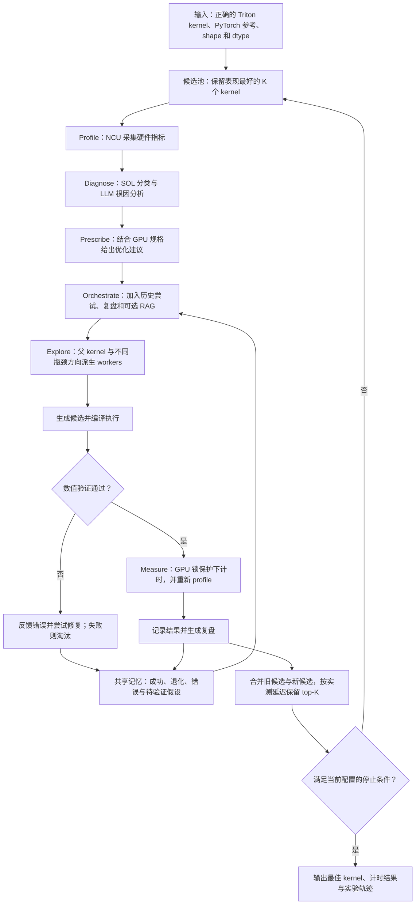
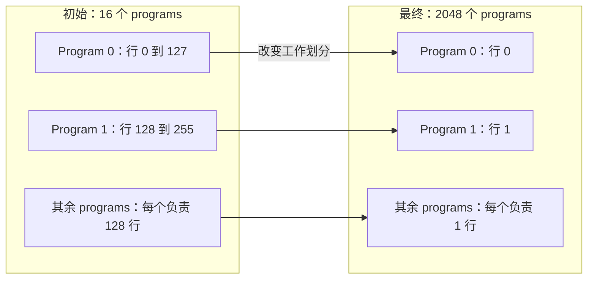

# KernelAgent：硬件反馈驱动的 GPU Kernel 优化

> [!abstract] 核心思路
> 把 GPU kernel 调优变成一个可执行的实验循环：**测硬件 → 提假设 → 改代码 → 验正确性 → 测速度 → 保留有效候选并复盘**。LLM 负责提出和解释方案；硬件测量与确定性控制代码负责决定哪些结果值得保留。

这篇是 [PyTorch 原文](https://pytorch.org/blog/kernelagent-hardware-guided-gpu-kernel-optimization-via-multi-agent-orchestration/)的阅读与源码笔记。可以和 [[Harness Engineering：以 Agent 为中心的工程实践]] 一起看：KernelAgent 给出了“上下文、工具、验证、状态、终止条件”如何落到具体工程中的例子；并行探索的收益和代价可联系 [[Subagent 的好处与适用边界]]。

## 1. 阅读范围与版本

这次看的是已有正确 Triton kernel 的**性能优化层**，初始 kernel 的生成与正确性修复是它的上游。

源码与产物分别固定到以下版本，避免后续仓库改动让说明失去依据：

- [KernelAgent 主仓库](https://github.com/meta-pytorch/KernelAgent/tree/e0647170da36ef9b059ac0bd3d60103aa4ed378b)：`e0647170da36ef9b059ac0bd3d60103aa4ed378b`。
- [公开优化产物](https://github.com/kaiming-cheng/kernelagent-optimization-artifacts/tree/56cf9183b527307538ccbe8f554a88502918d2d1)：`56cf9183b527307538ccbe8f554a88502918d2d1`，重点读 `04_Matrix_vector_multiplication/`。

**文章、当前实现、历史运行产物是三个不同层次的证据**。下面注明差异；代码片段均为阅读时重新整理的简化表达，完整实现以链接为准。本次做静态阅读，没有在 H100 上复现计时。

## 2. 整体流程：一轮之内并行，一轮之后共享经验



图是对控制流的概括：验证修复有次数上限，不是失败后无限循环。**不同候选的代码探索可以并行；同一 GPU 上用于比较的测量需要互斥**，否则 worker 会互相争抢资源，污染性能排序。

### 文章角色与实际代码的对应

文章里的“Agent”是职责划分。当前源码把它们实现为工具模块、LLM 调用和 Python 调度逻辑，并非每个角色都有一个独立、长期运行的聊天会话。

| 职责 | 当前实现入口 | 输入 → 输出 |
| --- | --- | --- |
| Profiling | `KernelProfiler.profile_kernel()` | kernel 与输入规格 → NCU 指标、元数据 |
| SOL 初步分类 | `RooflineAnalyzer.analyze()` | 指标 → compute / memory / underutilized 等分类 |
| Diagnose 与 Prescribe | `BottleneckAnalyzer.analyze()` | kernel、指标、GPU 规格 → 有证据的根因与建议 |
| 组织单个 worker 的优化循环 | `OptimizationOrchestrator.optimize_kernel()` | 诊断、历史、可选 RAG → 优化 prompt、候选与结果 |
| 全局搜索 | `OptimizationManager`、`BeamSearchStrategy` | 父候选与瓶颈方向 → worker 任务、下一轮候选池 |
| 正确性门禁 | `_verify_and_refine()` | 候选、测试 → 通过 / 修复 / 失败反馈 |
| 测速 | `Benchmark.benchmark_kernel()` | 已验证候选 → `time_ms`、PTX 指纹 |
| 跨轮记忆 | `shared_history`、`shared_reflexions` | 各 worker 返回结果 → 后续轮次的 prompt 上下文 |

对应源码：[profiler](https://github.com/meta-pytorch/KernelAgent/blob/e0647170da36ef9b059ac0bd3d60103aa4ed378b/triton_kernel_agent/opt_worker_component/profiling/kernel_profiler.py#L151)、[诊断与建议](https://github.com/meta-pytorch/KernelAgent/blob/e0647170da36ef9b059ac0bd3d60103aa4ed378b/triton_kernel_agent/opt_worker_component/prescribing/bottleneck_analyzer.py#L82)、[orchestrator](https://github.com/meta-pytorch/KernelAgent/blob/e0647170da36ef9b059ac0bd3d60103aa4ed378b/triton_kernel_agent/opt_worker_component/orchestrator/optimization_orchestrator.py#L311)、[manager](https://github.com/meta-pytorch/KernelAgent/blob/e0647170da36ef9b059ac0bd3d60103aa4ed378b/triton_kernel_agent/opt_manager.py#L567)。

## 3. 顺着代码理解闭环

### 3.1 诊断不是只给一个 memory-bound 标签

`BottleneckAnalyzer.analyze()` 把 kernel 源码、NCU 指标、GPU 规格和 SOL 分类一起放进 prompt，再解析结构化返回值。返回内容同时包含 `root_causes` 和 `recommended_fixes`；文章分开的诊断、处方职责，在这里由同一次分析调用承载。

有用的诊断应该能串起：

```text
观察：寄存器很多、active warps 很少、带宽未饱和
    → 假设：并发不足，无法有效隐藏访存延迟
    → 实验：减少每个 program 的工作集，增加 grid 并行度
    → 验证：延迟、寄存器、active warps 和带宽是否共同支持假设
```

这也是 [[CUDA Tiling]] 中“数据复用与资源占用之间取舍”的具体例子。大 tile 能增加复用，也可能占用过多寄存器，并减少可同时运行的工作。

### 3.2 单个 worker：先验正确性，再谈性能

[主循环约第 394–649 行](https://github.com/meta-pytorch/KernelAgent/blob/e0647170da36ef9b059ac0bd3d60103aa4ed378b/triton_kernel_agent/opt_worker_component/orchestrator/optimization_orchestrator.py#L394)可以压缩成下面的伪代码。变量名为说明而简化：

```python
for round_id in range(round_budget):
    metrics, diagnoses = profile_and_analyze(current_kernel)
    direction = choose_bottleneck(diagnoses, worker_bottleneck_id)
    prompt = make_prompt(current_kernel, direction, gpu_specs,
                         recent_attempts, recent_reflexions, optional_rag)
    candidate = generate_kernel(prompt)
    ok, candidate, error = verify_and_refine(candidate, tests)
    if not ok:
        record_failure(error)
        continue

    runtime = benchmark(candidate)       # GPU 锁保护
    new_metrics = profile(candidate)
    record_attempt_and_reflect(runtime, new_metrics)
    update_current_and_best_kernels(candidate, runtime, new_metrics)
```

源码中 `_verify_and_refine()` 调用 `verification_worker.verify_with_refinement()`；没有通过的候选不会走到后面的正常测速路径。[`kernel_subprocess.py`](https://github.com/meta-pytorch/KernelAgent/blob/e0647170da36ef9b059ac0bd3d60103aa4ed378b/triton_kernel_agent/opt_worker_component/benchmarking/kernel_subprocess.py#L15)明确假设正确性已由上游检查。因此单独调用 benchmark 不能作为“算对了”的证明。

另外，[`_update_kernels()`](https://github.com/meta-pytorch/KernelAgent/blob/e0647170da36ef9b059ac0bd3d60103aa4ed378b/triton_kernel_agent/opt_worker_component/orchestrator/optimization_orchestrator.py#L1082)分别追踪 **best runtime** 与 **best SOL**。资源利用率更高的版本可能更慢，选最终产物时必须看真实延迟。

### 3.3 多个 worker：beam search 保留其他路线

[`BeamSearchStrategy.select_candidates()`](https://github.com/meta-pytorch/KernelAgent/blob/e0647170da36ef9b059ac0bd3d60103aa4ed378b/triton_kernel_agent/opt_worker_component/searching/strategy/beam_search.py#L132)围绕父候选、瓶颈方向、模型和采样次数展开任务。经典的 `2 个父候选 × 2 个瓶颈方向` 就得到 4 个 worker；当前实现还允许额外的模型和采样维度，以及只展开部分父候选。

收集结果后，当前版本会：

1. 合并旧 beam 和成功的新候选。
2. 按规范化 PTX 指纹去重，减少“代码写法不同、编译结果相同”的重复候选。
3. 按 `time_ms` 从小到大排序，保留 top-K。

因此某个新实验退化，不必拖着整条搜索路线一起退化；老的好版本仍能留在候选池。源码见 [`update_with_results()`](https://github.com/meta-pytorch/KernelAgent/blob/e0647170da36ef9b059ac0bd3d60103aa4ed378b/triton_kernel_agent/opt_worker_component/searching/strategy/beam_search.py#L162)。

### 3.4 共享记忆是显式的数据传递

[`OptimizationManager._run_workers()`](https://github.com/meta-pytorch/KernelAgent/blob/e0647170da36ef9b059ac0bd3d60103aa4ed378b/triton_kernel_agent/opt_manager.py#L567)把最近的 `shared_history` 与 `shared_reflexions` 传给 workers，运行结束后再收集 `attempt` 和 `reflexion`。

这更像“每轮结束后整理实验记录，再广播给下一轮”。worker 不必读取其他 worker 的完整聊天历史，能看到的经验由调度层明确选择。当前默认历史窗口为最近 10 条；同一父候选的 NCU profile 也会缓存后共享，避免每个分支重复采集。

这里的 inference-time learning 是**通过上下文改变下一轮决策**，没有更新模型权重。

## 4. 结合真实 kernel：为什么 matvec 从约 9.5 ms 降到约 1.95 ms

### 4.1 工作负载与优化目标

公开产物的 [problem.py](https://github.com/kaiming-cheng/kernelagent-optimization-artifacts/blob/56cf9183b527307538ccbe8f554a88502918d2d1/04_Matrix_vector_multiplication/problem.py)计算：

$$
C_i=\sum_{k=0}^{K-1} A_{i,k}x_k,\qquad M=2048,\quad K=1{,}048{,}576
$$

基准脚本把浮点输入转成 BF16；kernel 用 FP32 累加，最后写 BF16。`problem.py` 本身的 `torch.rand()` 没有指定 BF16，复现时要同时看 [benchmark.py 的输入准备](https://github.com/kaiming-cheng/kernelagent-optimization-artifacts/blob/56cf9183b527307538ccbe8f554a88502918d2d1/benchmark.py#L123)。

**以下是基于形状的分析：**A 本身约 4 GiB，而 x 约 2 MiB。每个矩阵元素主要贡献一次乘加，因此这个大形状 matvec 的算术强度很低。需要检查的是能否高效流式读 A、提供足够多并发工作，并适当复用 x；不能直接套用追求高复用的大 GEMM tile。

### 4.2 初始版本：每个 program 处理 128 行

[input_kernel.py](https://github.com/kaiming-cheng/kernelagent-optimization-artifacts/blob/56cf9183b527307538ccbe8f554a88502918d2d1/04_Matrix_vector_multiplication/input_kernel.py#L28)的关键结构为：

```text
BLOCK_M = 128，BLOCK_K = 256
grid = ceil(M / BLOCK_M) = 16 个 programs

每个 program：
    保留 128 行的 FP32 累加状态
    沿 K 循环加载 [128, 256] 的 A tile 与 [256] 的 x
    对每一行做归约，更新累加状态
```

这里有两个值得同时检查的问题：**整个 grid 只有 16 个 programs**，可分发的独立工作很少；而一个 program 的二维工作集又很大。寄存器压力不仅来自累加器，还包括 A tile、乘积、索引及编译器安排的中间状态。

原始 [round 1 输入 NCU 指标](https://github.com/kaiming-cheng/kernelagent-optimization-artifacts/blob/56cf9183b527307538ccbe8f554a88502918d2d1/04_Matrix_vector_multiplication/optimization_trace/round_1/input_ncu_metrics.json)记录：每线程 254 个寄存器、active warps 约 6.25%、DRAM throughput 约 18.48%。这支持“工作划分和资源占用导致硬件未充分利用”的判断；单看其中一个指标不足以区分全部原因。

### 4.3 中间版本：试验会退化，历史最优可以保持

公开产物 [README](https://github.com/kaiming-cheng/kernelagent-optimization-artifacts/blob/56cf9183b527307538ccbe8f554a88502918d2d1/README.md)给出的各轮累计最优为：

| 轮次 | 1 | 2 | 3 | 4 | 5 | 6 | 7 | 8 |
| --- | --- | --- | --- | --- | --- | --- | --- | --- |
| 累计最优延迟 / ms | 6.803 | 6.202 | 6.202 | 4.031 | 4.031 | 4.031 | 4.031 | 1.956 |

**这不是每一轮新生成的 kernel 都越来越快。**例如公开的 [round 5 单 worker 计时](https://github.com/kaiming-cheng/kernelagent-optimization-artifacts/blob/56cf9183b527307538ccbe8f554a88502918d2d1/04_Matrix_vector_multiplication/optimization_trace/round_5/benchmark_results.json)约为 8.492 ms，明显退化，但先前的 4.031 ms 仍可留在 beam。

产物说明每轮仅展示 4 个 workers 中一个的轨迹，不能据此重建完整搜索树。第 4 轮展示的 [kernel.py](https://github.com/kaiming-cheng/kernelagent-optimization-artifacts/blob/56cf9183b527307538ccbe8f554a88502918d2d1/04_Matrix_vector_multiplication/optimization_trace/round_4/kernel.py)仍是二维 tile，配置为 `BLOCK_M=32`、`BLOCK_K=512`、`num_stages=1`、`num_warps=4`，grid 为 64。

### 4.4 最终版本：每个 program 算一行

最终 [optimized_kernel_beam_search.py](https://github.com/kaiming-cheng/kernelagent-optimization-artifacts/blob/56cf9183b527307538ccbe8f554a88502918d2d1/04_Matrix_vector_multiplication/optimized_kernel_beam_search.py#L7)改成下面的计算结构。这是按源码重写的伪代码，省略了边界 mask、stride 和 wrapper：

```python
row = program_id(0)
acc = float32(0)
for k_start in range(0, K, 1024):
    a = load(A[row, k_start : k_start + 1024])
    x_tile = load(x[k_start : k_start + 1024])
    acc += sum(float32(a) * float32(x_tile))
store(C[row], bfloat16(acc))

# grid = (M,)：2048 个独立 programs
```



从代码能确认的变化：

- program 数从 16 增加到 2048，提供更多可调度的独立任务。
- 一个 program 处理一行，一次加载一维 K tile，累加状态收缩为标量。
- `BLOCK_SIZE_K=1024`，比初始的 256 更大；减少 M 维工作集与增大 K tile 是一起发生的。
- 最终 launch 没有显式指定 `num_warps` 或 `num_stages`，由 Triton 默认行为决定。

> [!note] 一行一个 program，不是一行一个 CUDA thread
> [`tl.program_id(0)`](https://triton-lang.org/main/python-api/generated/triton.language.program_id.html)标识 program instance。program 内的向量加载、乘法和归约仍由一组线程协作执行。文章个别位置写 one-row-per-thread，理解该代码时应以 program 为单位。

### 4.5 用指标检查：优化了什么

下面直接对照公开的 [round 1 输入指标](https://github.com/kaiming-cheng/kernelagent-optimization-artifacts/blob/56cf9183b527307538ccbe8f554a88502918d2d1/04_Matrix_vector_multiplication/optimization_trace/round_1/input_ncu_metrics.json)和 [round 8 输出指标](https://github.com/kaiming-cheng/kernelagent-optimization-artifacts/blob/56cf9183b527307538ccbe8f554a88502918d2d1/04_Matrix_vector_multiplication/optimization_trace/round_8/optimized_ncu_metrics.json)：

| 指标 | 初始 | 最终 |
| --- | --- | --- |
| 每线程寄存器数 | 254 | 32 |
| Active warps / peak | 6.25% | 95.22% |
| DRAM throughput / peak | 18.48% | 91.11% |
| DRAM bytes/s | 约 452 GB/s | 约 2229 GB/s |
| Long scoreboard stall 指标 | 19.44% | 67.81% |

寄存器下降、active warps 和带宽上升，与工作划分改动形成了相互支持的证据。值得注意的是 **long scoreboard 指标反而上升**：不能要求每个 stall 百分比都随延迟一起下降。它的统计分母与整体运行时间不同，需要结合吞吐和最终延迟判断，不应单独把它当优化目标。

公开 [round 8 计时 JSON](https://github.com/kaiming-cheng/kernelagent-optimization-artifacts/blob/56cf9183b527307538ccbe8f554a88502918d2d1/04_Matrix_vector_multiplication/optimization_trace/round_8/benchmark_results.json)是约 **1.9516 ms**；README 的汇总复测约 **1.956 ms**。README 中初始 kernel 为 9.510 ms、`torch.compile` 为 2.069 ms：按该组数据计算，分别约 **4.86×** 和 **1.06×**。大幅改善差的初始 kernel，与超过一个成熟 baseline 的幅度，是两个不同的比较。

## 5. 原文与产物里需要辨析的地方

### 5.1 复盘文本会解释错已经发生的事情

[round 8 strategy.json](https://github.com/kaiming-cheng/kernelagent-optimization-artifacts/blob/56cf9183b527307538ccbe8f554a88502918d2d1/04_Matrix_vector_multiplication/optimization_trace/round_8/strategy.json)建议缩小 K tile、增加 warps、缓存 x；[reflexion.txt](https://github.com/kaiming-cheng/kernelagent-optimization-artifacts/blob/56cf9183b527307538ccbe8f554a88502918d2d1/04_Matrix_vector_multiplication/optimization_trace/round_8/reflexion.txt)把成功归因于这些措施。

但最终源码是 `BLOCK_SIZE_K=1024`，没有显式增加 `num_warps`，也没有在源码层显式实现 shared-memory 缓存 x。编译器可能使用 shared memory，但这不能证明复盘所述方案被执行了。

**成功的计时结果，并不保证 LLM 给出的因果解释正确。**共享记忆最好同时保留代码差异、测量数据与模型解释，并给解释标记证据状态；否则错误归因也会被跨轮传播。这是阅读产物得到的工程启发，不代表仓库已经实现了这种证据标记。

### 5.2 SOL 是代理指标，不能直接当理论最优距离

当前 [`RooflineAnalyzer`](https://github.com/meta-pytorch/KernelAgent/blob/e0647170da36ef9b059ac0bd3d60103aa4ed378b/kernel_perf_agent/kernel_opt/roofline/ncu_roofline.py#L142)使用：

```text
compute = sm__throughput.avg.pct_of_peak_sustained_elapsed
memory  = gpu__compute_memory_throughput.avg.pct_of_peak_sustained_elapsed
efficiency = max(compute, memory)
```

这是 NCU SOL 风格的利用率代理，并没有在这里通过 FLOPs、实际字节数和算术强度完整构造传统 roofline。`memory` 这个指标也不能在所有 kernel 上直接替换成 DRAM 带宽；本例最终两者恰好都是约 91.11%。

因此“效率 89%”不能解读成“所有程序只剩 11% 加速空间”，高 SOL 也不保证算法已经减少到最少工作量。

### 5.3 `do_bench` 的 25、100 是时间预算

[`kernel_subprocess.py` 的实际调用](https://github.com/meta-pytorch/KernelAgent/blob/e0647170da36ef9b059ac0bd3d60103aa4ed378b/triton_kernel_agent/opt_worker_component/benchmarking/kernel_subprocess.py#L156)把配置直接传给 `tt.do_bench(warmup=warmup, rep=rep, return_mode="mean")`。[Triton 官方文档](https://triton-lang.org/main/python-api/generated/triton.testing.do_bench.html)定义 `warmup` 和 `rep` 的单位是 **ms**，不是固定迭代次数。

公开产物的 `benchmark.py` 传入 `warmup=500`、`rep=100`。它的注释以及文章中“100 次重复”等表述，不能直接作为真实执行次数的依据；复现时应看函数调用和所用 Triton 版本。

### 5.4 停止条件要看调用链

当前 [`BeamSearchStrategy.should_terminate()`](https://github.com/meta-pytorch/KernelAgent/blob/e0647170da36ef9b059ac0bd3d60103aa4ed378b/triton_kernel_agent/opt_worker_component/searching/strategy/beam_search.py#L263)的全局条件是达到 `max_rounds`。

单 worker 的 roofline 配置默认阈值为 95%。虽然 `RooflineAnalyzer.should_stop()` 定义了收敛判断，但当前 orchestrator 调用它时先要求“新候选是最佳延迟版本且已达到 roofline 阈值”。因此不能根据 README 的概括，就认定这一调用路径会在低于阈值、连续几轮没改善时自动停止整个 beam search。

## 6. 怎样理解文章的性能结论

[原文](https://pytorch.org/blog/kernelagent-hardware-guided-gpu-kernel-optimization-via-multi-agent-orchestration/)报告：H100 上 100 个 KernelBench L1 任务，相对早期 correctness-only 生成结果的几何平均加速为 2.02×，相对默认 `torch.compile` 为 1.56×，其中 65 个任务更快。后者使用静态 shape、default mode、关闭 CUDA Graph。

这些结果支持它作为 kernel 优化流程的价值；推广时仍需要固定 GPU、输入、精度、验证容差和计时协议。本例的 one-row-per-program 也应理解为该大 K matvec 的测量结果，不能替代小 M、其他 K 或其他 GPU 上的实验。

## 7. 对搭建自己的 Agent pipeline 的启发

结合源码和运行产物，可以提炼出以下设计原则：

1. **把验收条件做成可执行接口。**候选必须通过验证，排序依据实测延迟；模型没有资格自行宣布完成。
2. **让模型自由提出方案，让代码控制候选保留与资源互斥。**beam 更新、预算、GPU 锁适合确定性实现。
3. **保留失败证据，也检查成功归因。**退化方案能提示资源取舍；成功复盘也可能需要纠错。
4. **给搜索留结构变化的空间。**本例关键是从多行二维 tile 改成每行一个 program；只搜索几个 launch 参数容易错过它。
5. **把每轮落成可审计产物。**输入、诊断、prompt、候选、验证结果、计时与复盘组成实验链，方便人回查。

继续阅读时，建议先沿 `OptimizationManager → BeamSearchStrategy → OptimizationOrchestrator` 理解控制流，再沿 matvec 的 `input_ncu_metrics.json → strategy.json → kernel.py → benchmark_results.json → reflexion.txt` 检查证据链。对照 [[book-notes/Performance Analysis and Tuning on Modern CPUs/Chapter 2 Measuring Performance|性能测量读书笔记]]，能看到同样的“公平测量、避免指标误读、用实验检验假设”的方法。
