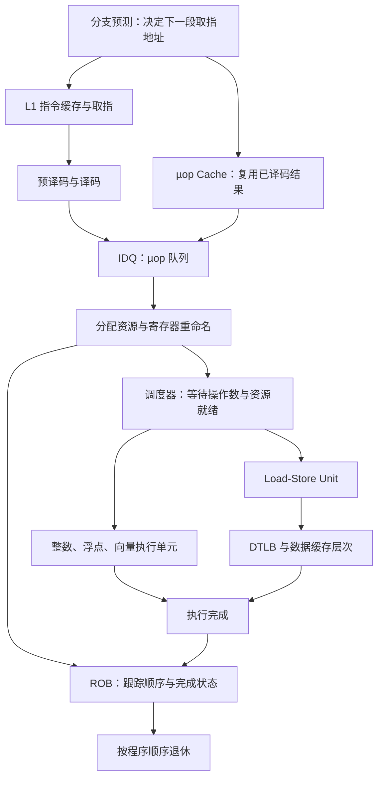

# Chapter 3 CPU Microarchitecture

> [!abstract] 先记住这一句
> **现代 CPU 会尽量提前找活、并行干活、提前取数据，但不能凭空消除真正的数据依赖，也不能无限增加资源。** 性能分析要看的是：有用的指令和数据能不能及时送到，执行资源能不能用起来，以及做过的工作最后有多少真正提交。

前一章 [[book-notes/Performance Analysis and Tuning on Modern CPUs/Chapter 2 Measuring Performance|Modern CPUs Ch.2]] 解决“怎么证明快慢”；这一章建立解释快慢所需的硬件模型。主线按原书 §3.1–3.9 整理，示意代码、计算例子和文末排查表用于帮助理解，不是实测结果。

## 1. ISA 是约定，微架构是实现（§3.1）

**指令集架构（ISA）** 规定软件能使用哪些指令、寄存器、数据类型及寻址方式；**微架构（microarchitecture）** 决定处理器内部如何完成这些操作。

可以把 ISA 理解成“允许点哪些菜、每道菜的结果是什么”，微架构则是“厨房配多少人、怎么排队、怎么同时做”。同一套 ISA 可以由追求低功耗的小核或追求性能的大核实现，所以能运行相同机器码，不代表速度相同。

- ARM、RISC-V 主要采用 **load-store** 风格：算术操作使用寄存器，访存由 load/store 指令完成。
- x86 是 **register-memory** 风格：算术指令也可以带内存操作数。进入核心后，一条复杂指令可能被拆成多个微操作（µop），分别完成加载、计算等工作。
- SIMD、矩阵指令与低精度数据类型扩展，让一条指令能表达更多计算。实际使用仍取决于目标 CPU 支持的扩展。

软件看到的架构寄存器可参考 [[system-programming/x86 registers]]。后面说的“物理寄存器”是微架构内部资源，不能和汇编里能直接命名的寄存器数量混为一谈。

## 2. 流水线：让不同指令的不同阶段重叠（§3.2）

书中先用五级流水线说明基本思想：

```text
取指 IF → 译码 ID → 执行 EXE → 访存 MEM → 写回 WB

周期       1    2    3    4    5    6    7
指令 A    IF   ID  EXE  MEM   WB
指令 B         IF   ID  EXE  MEM   WB
指令 C              IF   ID  EXE  MEM   WB
```

若每级耗时一个周期，A 仍要经过五个周期才能完成，但流水线填满后，理想情况下每个周期都能完成一条指令。

**流水线首先改善吞吐，不意味着单条指令的延迟同比降低。** 真实高性能 CPU 的阶段更多，也有更复杂的缓冲和调度逻辑，不能把这张教学图直接当作现代核心的实现图。

流水线会被三类 **hazard（冒险）** 卡住：

| 类型 | 卡在哪里 | 硬件应对思路 |
| --- | --- | --- |
| 结构冒险 | 两条指令同时争用一个执行资源 | 增加资源，或让其中一条等待 |
| 数据冒险 | 后续操作需要尚未产生的值，或寄存器复用造成约束 | 结果转发、寄存器重命名、等待真依赖 |
| 控制冒险 | 分支还没算出，不知道下一步取哪里的指令 | 分支预测与推测执行 |

### RAW、WAR、WAW：哪些依赖能消掉？

| 依赖 | 例子，按程序顺序从左到右 | 含义 | 寄存器重命名能否消除 |
| --- | --- | --- | --- |
| RAW：Read After Write | `R1 = R0 + 1; R2 = R1 + 2` | 第二条确实需要第一条的计算结果 | 不能；结果转发可以缩短等待 |
| WAR：Write After Read | `R1 = R0 + 1; R0 = R2 + 2` | 后一次写不能破坏前一次读所需的旧值 | 能，用不同物理寄存器保存新旧版本 |
| WAW：Write After Write | `R1 = R0 + 1; R1 = R2 * 3` | 两次写复用了同一个名字，最终应保留后一次值 | 能，为两次写分配不同物理寄存器 |

**RAW 是值的依赖；WAR、WAW 在这里是寄存器名字复用造成的假依赖。** 重命名相当于给同一变量的不同版本分别找存放位置，不会让尚未计算出来的结果提前出现。

结果转发（bypassing / forwarding）则让后续指令尽早拿到前一条的输出，而不必等到完整写回流程结束。

## 3. 单线程也能并行：乱序、超标量与推测（§3.3）

**指令级并行（ILP）** 指同一个指令流内部可重叠或并行执行的工作。单线程不等于每次只能执行一条指令。

### 3.1 乱序执行：前面的等数据，后面独立的先做

```text
A: x = load(p)     // 假设很慢
B: y = x + 1       // 真正依赖 A，必须等
C: z = u + v       // 与 A、B 独立，可以先执行
```

顺序执行会让 C 也被 A 挡住；**乱序执行（OOO）** 可以让 C 在操作数和资源都就绪时提前执行，填补等待期间的空闲。

但乱序有两个边界：

1. **必须尊重真实依赖和资源约束。** 不能因为 B 着急就凭空得到 x。
2. **向架构提交结果时仍按程序顺序退休（retire）。** 执行完不等于已经退休；后面的指令可能算完了，还在等前面的指令确定下来。

两个关键结构：

- **ROB（Reorder Buffer，重排序缓冲区）**：跟踪在途指令的状态、完成情况和程序顺序，支持按序退休及推测恢复。容量影响 CPU 能向前看多远。
- **RS（Reservation Station，保留站）/ scheduler**：保存等待执行的工作，检查操作数和执行资源是否就绪，就绪后调度执行。

实际能挖掘多少 ILP，还受 RS、物理寄存器、load/store 队列等资源限制。ROB 大不等于所有长延迟都能藏住。

书中也比较静态和动态调度：编译器可以在编译期重排、展开循环；硬件则能依据运行时操作数就绪情况动态调度，适应难以预先确定的访存延迟。寄存器重命名是 Tomasulo 思路的重要组成部分。

### 3.2 超标量：一个周期可以发射多条指令

**超标量（superscalar）** 通过多套执行资源等设计，让同一周期处理多条指令。

- 流水线：不同指令的不同阶段重叠。
- 超标量：同一阶段有能力并行处理多条指令。
- 乱序执行：绕开暂时卡住的工作，寻找已经就绪的指令。

三者可以一起工作，但“支持多发射”只是能力上限；依赖链太长、指令都争用同一个端口、数据不到位时，都吃不满这个宽度。

### 3.3 推测执行：分支没确定，也先沿预测路径做

```cpp
if (a < b)
    foo();
else
    bar();
```

CPU 可以先预测走 `foo()`，提前取指、译码和执行。预测正确，就减少了等分支结果的空白；预测错误，就丢弃错误路径上的相关工作，恢复到正确路径。

**预测给出“可能走哪里”，推测执行负责“先沿那里做”。** 错误路径的结果不能提交为架构状态，但这不表示执行过程完全没有微架构影响。

### 3.4 分支预测不只是在猜 if 的真假

| 分支类型 | 需要尽早知道什么 |
| --- | --- |
| 直接无条件跳转、直接调用 | 已知会跳，但要尽早拿到目标地址 |
| 条件分支 | 跳不跳；如果跳，目标在哪里 |
| 间接调用、间接跳转、返回 | 多个可能目标中，这次会去哪里 |

**BTB（Branch Target Buffer）缓存目标地址信息**；方向预测还会利用分支自己的历史，以及其他分支的历史关联。循环、长期偏向一侧的分支，也可以由更有针对性的预测机制处理。

因此，代码里有 `if` 不等于一定慢。分支行为是否稳定、输入分布是否可预测，以及预测错误后损失多少工作，才是需要分析的因素。

## 4. SIMD：一条指令处理多个数据元素（§3.4）

```cpp
for (int i = 0; i < N; ++i)
    c[i] = a[i] + b[i];
```

对 64-bit 的 `double`，256-bit 向量可以容纳 4 个元素，一条向量加法就能表达 4 组逐元素加法。

$$
\text{lane 数} = \frac{\text{向量位宽}}{\text{元素位宽}}
$$

这里的 lane 是向量内处理一个元素的数据通路。SIMD 提取的是**数据级并行**，和“同时发射多条独立指令”的 ILP 要区分；两者可以叠加。

使用方式从手写汇编、intrinsics 到编译器自动向量化。SVE、RVV 还提供可伸缩向量编程方式，使代码能适应不同向量长度。最后一轮不足一整个向量时，可以通过标量尾部、mask 或相应的向量长度控制处理，具体取决于 ISA 和生成的代码。

**4 个 lane 不等于整个程序必然快 4 倍。** 加载、存储、循环开销、实际向量化程度和内存带宽，都可能限制收益。后面的缓存与主存部分，就是在解释“算得更多以后，数据能否跟上”。

书中还介绍 AMX、SME 等矩阵计算扩展。SIMD 的用途也不限于数值计算，字符串扫描、JSON 解析、压缩、排序和数据库过滤都可能受益。

## 5. 线程级并行：多核、SMT 与大小核（§3.5）

| 机制 | 增加或复用的是什么 | 主要限制 |
| --- | --- | --- |
| 多核 | 多套物理核心，运行不同线程 | 功耗、散热，以及共享缓存、互连、内存带宽 |
| SMT | 同一物理核同时容纳多个线程，用其他线程填补空闲执行机会 | 执行资源和缓存等仍共享，可能互相争抢 |
| 混合架构 | 同一处理器里配置不同性能和能效的核心 | 任务放在哪里、迁移成本、指令集兼容与调度策略 |

### SMT 的两个逻辑核，不等于两个完整物理核

SMT 为线程保留各自的架构上下文，但共享许多核心资源。一个线程等数据时，另一个线程的就绪指令可能填上空位；如果两个线程已经在争用同一种紧缺资源，收益就有限，单线程延迟还可能变差。

所以应区分：

- **系统吞吐提高**：相同时间总共完成更多工作。
- **单个任务变快**：某个线程自己的完成时间缩短。

前者发生不代表后者也发生。这也解释了第二章为什么强调控制后台任务：占用了同一物理核的 SMT 邻居，即使显示为另一个逻辑 CPU，也可能影响测量。

多核同样受共享资源约束。内存带宽已经饱和时，再加计算核心也不一定增加吞吐。大小核则进一步提醒我们：逻辑 CPU 数量相同，不代表这些 CPU 的单线程能力相同。

## 6. 缓存与主存：让数据及时到达（§3.6）

### 6.1 为什么要分层？

离执行单元近的存储希望快，但容量、成本和访问延迟存在取舍。因此采用小而快的 L1、较大的 L2，再到 LLC（末级缓存，常见为 L3）和主存。某一级缓存是核心私有还是共享，取决于具体设计。

缓存依赖两个性质：

- **时间局部性**：刚用过的数据，很快还会再用。
- **空间局部性**：刚访问一个位置，很快也会访问邻近位置。

缓存以 **cache line** 为单位搬运和管理数据。原书给出的常见大小是 64 B，也举了 Apple L2 使用 128 B line 的例子；应按具体层级和处理器确认。

按 64 B line 举例，一行可容纳 8 个 `double`。连续遍历时，取来一行可以使用其中多个元素；分散访问时，可能只用了很少一部分就要去取下一行。

### 6.2 总容量够，也可能发生冲突

原书用三种放置方式说明取舍：

| 方式 | 一个内存块能放哪里 | 取舍 |
| --- | --- | --- |
| 直接映射 | 固定一个位置 | 简单，但容易冲突 |
| 全相联 | 任意位置 | 灵活，但查找硬件成本高 |
| 组相联 | 固定一组中的任意一路 | 在灵活性和实现成本间折中 |

书中的 **32 KiB、64 B line、8 路组相联** 例子：

```text
总 line 数 = 32768 / 64 = 512
组数       = 512 / 8 = 64

地址 → 确定组 → 在该组的 8 路中检查 tag 和有效位 → 找到 line
```

教学模型中，block address 对组数取模得到组号，地址可分成 `tag | set index | line offset`。这说明：**多个热点块即使总量远小于整个缓存，只要挤进同一组，也可能互相驱逐。** 不应把这个简单映射公式当作所有缓存层级的固定实现。

未命中时还需要替换策略，例如 LRU 或其他策略。局部性与工作集的关系可联系 [[MLSys/LRU 抖动（LRU Thrashing）与 KV Cache]]；其中的软件缓存例子有助于理解反复驱逐，但不能据此假设硬件缓存都使用严格 LRU。

### 6.3 写缓存要分别看两个问题

| 问题 | 策略 | 含义 |
| --- | --- | --- |
| 写命中以后，何时更新下一层？ | write-through | 同时向下一层写 |
| 同上 | write-back | 先修改本层并标脏，之后再写回 |
| 写未命中，是否把 line 分配进缓存？ | write-allocate | 先取得 line，再修改 |
| 同上 | no-write-allocate | 不为这次 miss 把 line 装入本层 |

它们是两个维度，不能把 write-back 和 write-allocate 当作互斥选项。书中重点介绍的是常见的 write-back 与 write-allocate 组合。

### 6.4 未命中率重要，延迟能否隐藏也重要

原书给出平均访问延迟的基本模型：

$$
\text{平均访问延迟} = \text{命中时间} + \text{未命中率} \times \text{未命中额外代价}
$$

这个模型可以沿存储层次递归理解。但不能直接把“miss 次数 × 单次延迟”当成程序总停顿时间：乱序执行可能用其他工作覆盖等待，多个独立访存也可能重叠。

**预取（prefetch）** 则试图在真正需要前把数据拿来。硬件预取器识别常见访问模式，软件也可以显式发起预取。收益取决于是否足够提前、地址是否可预测；多余预取也会占用带宽和缓存空间。

### 6.5 主存的延迟和带宽是两回事

- **延迟（latency）**：发出一次请求后，多久能用到数据。
- **带宽（bandwidth）**：单位时间能搬来多少字节。

书中给出的 CPU 所见主存延迟是约 50–150 ns 的量级，不是固定硬件常数。DRAM 器件的读延迟之外，还包括缓存控制器、互连、内存控制器和排队等成本。

DRAM 部分还要分清：

- **rank**：一组共同提供数据的 DRAM 芯片；多个 rank 可提供交错访问机会，但不等于多个独立内存通道。
- **channel**：内存控制器与内存之间的独立通道，可增加总传输能力。
- **interleaving**：把地址分散到多个可并行服务的资源上，避免连续访问只落到一条通道。

按原书 DDR4 例子，2400 MT/s、每次传输 8 B：

$$
\text{单通道理论带宽} = 2400 \times 10^6 \times 8
= 19.2\ \text{GB/s}
$$

这里 MT/s 已经表示每秒传输次数，不能再因 DDR 重复乘 2。双通道理论值为 38.4 GB/s，实际值受访问模式和协议开销等影响。

GDDR、HBM 则从不同实现路径提供更高带宽，HBM 的重要特征是堆叠与宽接口。**带宽更高不等于所有程序都更快**：后一访问必须等待前一访问结果的依赖链，仍然难以靠更多并行通道消除等待。

## 7. 虚拟内存：拿数据以前，还要知道它在哪里（§3.7）

程序使用虚拟地址，物理内存使用物理地址。操作系统维护映射，硬件按页表格式完成翻译与权限检查。

以 **4 KiB 页** 为例：

```text
虚拟地址 = 虚拟页号 | 页内偏移（低 12 bit）
                    ↓ 页表映射
物理地址 = 物理页号 | 同一个页内偏移
```

翻译改变页号，页内偏移保持不变。多级页表按需分配中间结构，避免为稀疏地址空间准备一张巨大连续表，但查表可能需要多次访存。

### 7.1 TLB 缓存的是翻译，不是程序数据

**TLB（Translation Lookaside Buffer）** 保存近期使用的地址翻译，通常也有指令侧 ITLB、数据侧 DTLB 和更大的共享层级。

| 情况 | 缺的是什么 | 接下来可能发生什么 |
| --- | --- | --- |
| cache miss | 请求的数据或指令不在这一层缓存 | 向更低层缓存或内存取 |
| TLB miss | 翻译不在这一层 TLB | 查下一层 TLB；整个层级都未命中才需要 page walk |
| page fault | 访问的映射或权限等不能满足要求 | 进入操作系统处理，可能分配物理页、换入页面或报告非法访问 |

**TLB miss 不等于缺页，也不意味着一定访问磁盘。** 有效映射可能一直在页表中，只是没有缓存在 TLB 里。

当需要 **page walk** 时，硬件 page walker 遍历页表；页表条目本身也可以命中缓存。还有 paging-structure cache 缓存中间层信息，减少遍历工作，所以一次多级页表查询不必等价于多次完整 DRAM 访问。

L1 数据缓存的部分查找还可能和 TLB 查询重叠，不能把每次 load 都想成“完整翻译结束，再从头查缓存”的严格串行流程。

### 7.2 Huge Pages：让一条翻译覆盖更大范围

对齐且完整以相应页大小映射的 10 MiB 区域：

```text
4 KiB 页：10 MiB / 4 KiB = 2560 页
2 MiB 页：10 MiB / 2 MiB =    5 页
```

Huge Pages 减少覆盖同一范围所需的页数，从而减轻 TLB 压力；它不是把数据装进一个更大的数据缓存。

代价是分配和内存利用的取舍。较大的物理连续块更难获得，运行时可能需要内存整理，影响分配延迟。是否值得启用，应围绕实际的地址翻译瓶颈和延迟要求判断。

> [!note] 本节的页大小是例子
> 这里沿用原书的 x86 4 KiB / 2 MiB 例子。具体可用页大小和页表格式取决于体系结构、处理器与操作系统配置，不把示例推广成所有平台的统一默认值。

## 8. 把机制串起来：Golden Cove 核心（§3.8）

原书使用 Intel Golden Cove 作为具体案例。下面是**功能关系的简化图**，省略部分队列、旁路和恢复路径；不是逐级时序图，也不是整个处理器封装的图。



### 8.1 前端：持续供应 µop

前端负责取指、识别指令边界、译码，再通过 IDQ 供给后端。µop Cache 缓存已经译码的结果，重复执行热点代码时可以避开部分译码工作；复杂指令还可能从微码序列获得 µop。

**L1 I-cache 保存指令字节，µop Cache 保存译码结果。** 二者解决的问题不同。后端再强，如果前端没能及时供应足够工作，也发挥不出来。

### 8.2 后端：重命名、找就绪工作、执行、退休

- **RAT（Register Alias Table）** 跟踪架构寄存器与物理寄存器的映射。
- **PRF（Physical Register File）** 保存物理寄存器中的值。
- **ROB** 跟踪在途工作与程序顺序，支撑按序退休。
- **RS / scheduler** 在操作数就绪后，把工作送到能执行它的端口和单元。

一个执行端口可能连接多种执行单元；一种操作也可能只有少数端口能处理。两个就绪操作如果争用同一个可用端口，仍需等待。**“核心有很多端口”不等于每种指令都能任意并行。**

某些指令还能被特殊处理：例如清零 idiom、部分寄存器间 move 可以减少执行单元的实际工作。它们仍消耗某些流水线资源，不能简单理解成“完全免费”。查看实际机器码可结合 [[命令行工具/objdump]]。

原书案例中的几个数值用于理解各阶段的容量和带宽差异：

| 资源 | 原书 Golden Cove 案例 |
| --- | --- |
| 取指 | 每周期最多 32 B 指令字节 |
| 译码 / µop Cache 供给 | 分别最多 6 条宏指令 / 8 个 µop 每周期 |
| 分配宽度 | 每周期最多 6 个 µop |
| ROB | 512 个条目 |
| L1 I-cache / D-cache | 32 KiB / 48 KiB |
| L2 | 客户端 1.25 MiB，服务器配置 2 MiB |

这些是书中案例的规格，**不是所有 CPU 的常数，也不应混用“指令数”“µop 数”“字节数”比较宽度。** 学习时先记职责和约束，遇到目标机器再查具体参数。

### 8.3 LSU：访存也是有队列、有并行度上限的

**Load-Store Unit（LSU）** 负责地址生成、load/store 跟踪、缓存访问及相关依赖处理。

- **AGU** 计算有效地址。
- **Load Buffer / Store Buffer** 跟踪尚未完成的相关操作。
- **Fill Buffer** 跟踪和承接未命中后取回的 cache line；同一 line 上的多个请求可以合并处理。
- **Store-to-load forwarding** 允许后续 load 在条件满足时，直接取得更早 store 暂存在缓冲区里的值。

对 write-allocate 的普通部分写，可能先要取得对应 cache line，再修改其中的字节。合并写入可减少下层流量；non-temporal 访问则提供不同的缓存使用方式，适用性取决于具体指令及访问模式，不能把所有写操作都视为相同成本。

如果更早 store 的地址还没确定，CPU 还可能预测后续 load 是否与它冲突，这叫 **memory disambiguation（内存消歧）**。错误地让实际相关的 load 提前执行，需要恢复并重做相关工作。

> [!warning] 三种顺序不要混为一谈
> 执行完成的顺序、指令退休的顺序，以及内存操作对其他核心的可见顺序，是不同问题。乱序执行仍需满足 ISA 的内存顺序约束；不能据此把 x86 与 ARM 的内存模型看成一样。跨线程同步另见 [[language/C++/memory order]]。

## 9. PMU：给上面的模型接上观测手段（§3.9）

**PMU（Performance Monitoring Unit）** 是处理器提供的性能监控设施集合；**PMC（Performance Monitoring Counter）** 是其中用来累计事件的硬件计数器。

可以观察的事件包括周期、退休指令、缓存未命中和分支预测失败等。这样才能把“我猜它在等内存”推进为“相关事件是否支持这个假设”。

- **固定计数器**：测量预先规定的事件。
- **可编程计数器**：选择支持的事件进行计数。
- **计数器数量有限**：可观察的事件往往远多于可同时使用的计数器；分析工具可能轮换事件组进行 multiplexing，细节留到第五章。
- **事件有型号差异**：名称相近不代表语义、计数范围完全相同。应以目标微架构与工具的事件定义为准。

Linux perf、VTune 等工具封装了计数器配置和读取。第三章只需先建立“硬件机制 → 可观察事件”的联系，后续再学习如何采样与解释指标。

## 10. 读完以后，怎样把概念用起来？

下表是根据本章机制整理的排查入口，**是待验证的假设，不是看到现象就能下的诊断**。

| 观察到的现象 | 值得追问的硬件问题 |
| --- | --- |
| 单线程没有达到预想吞吐 | 是否被真依赖链限制？前端供给不足？某类执行端口拥挤？ |
| SIMD 后收益不明显 | 是否真的向量化？是否受加载、存储或主存带宽限制？ |
| 加线程后吞吐不再增长 | 共享带宽、缓存、互连等是否已成为瓶颈？ |
| 同一程序换一组输入就明显变慢 | 分支可预测性、局部性、访问页数是否改变？ |
| 工作集一增大，耗时突然上升 | 是否跨过某级缓存或 TLB 的有效覆盖范围？ |
| 另一线程启动后，当前任务变慢 | 是否共享 SMT 物理核，或争用缓存和内存带宽？ |

和第二章连起来，工作顺序就是：固定有代表性的负载，确认差异可信，再根据微架构提出假设，收集能区分假设的证据，修改后重新测量。

## 自测：能解释这些，就抓住了主线

1. 五级流水线为什么能每周期完成一条指令，却不意味着单条指令只花一个周期？
2. 寄存器重命名为什么能消除 WAR/WAW，却不能消除 RAW？
3. 指令已经执行完成，为什么还可能不能退休？
4. 超标量、SIMD、多核和 SMT 各自提取什么并行性？
5. 为什么缓存总容量没用满，也可能反复 miss？
6. cache miss、TLB miss 和 page fault 分别缺什么？
7. Huge Pages 为什么有助于地址翻译，却不保证每个程序都更快？
8. 前端供给、依赖链、端口、数据访问，分别可能怎样限制后端？

## 来源与回看位置

主线来自用户提供的 Denis Bakhvalov，*Performance Analysis and Tuning on Modern CPUs*，Second Edition，Chapter 3 “CPU Microarchitecture”，**PDF 第 38–76 页，与书内页码一致**。本笔记是概念整理，未在目标 CPU 上进行性能实验。

| 想回看什么 | 原书位置 |
| --- | --- |
| ISA 与流水线、三类 hazard | §3.1–3.2，pp. 38–41；Figure 3.1 |
| OOO、调度、超标量、推测与分支预测 | §3.3，pp. 41–47；Figures 3.2–3.4 |
| SIMD、向量化与矩阵扩展 | §3.4，pp. 47–49；Figure 3.5 |
| 多核、SMT 与混合架构 | §3.5，pp. 49–53；Figure 3.6 |
| 缓存组织、写策略、预取 | §3.6.1，pp. 54–57；Figure 3.7 |
| DRAM、rank/channel、带宽、GDDR/HBM | §3.6.2，pp. 57–61；Table 3.1，Figures 3.8–3.10 |
| 虚拟内存、页表、TLB、Huge Pages | §3.7，pp. 61–64；Figures 3.11–3.13 |
| Golden Cove 前端、后端、LSU 与 TLB 层次 | §3.8，pp. 64–72；Figures 3.14–3.17 |
| PMU 与 PMC | §3.9，pp. 72–75；Figures 3.18–3.19 |
| 原书练习与章末总结 | pp. 75–76 |
